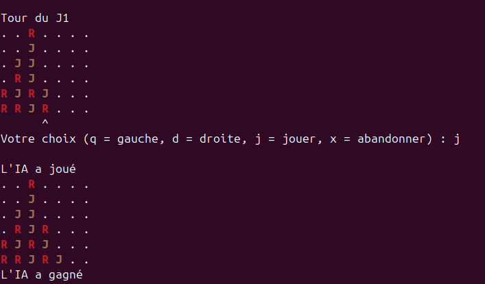

# IA Puissance4

Jeu de Puissance 4 dans le terminal, en langage C, avec deux modes :
- **Joueur contre Joueur**
- **Joueur contre IA**, basée sur l'algorithme **minimax** (5 coups d'avance)

## Aperçu


## Compilation et lancement

Il faut `gcc` et `make`.

```
make
./puissance4
```

Pour vérifier l'absence de fuites mémoire (optionnel) :

```
valgrind --leak-check=full ./puissance4
```

## Comment jouer

Un curseur `^` indique la colonne visée. À chaque tour :

| Touche | Action |
|--------|--------|
| `q` | déplacer le curseur à gauche |
| `d` | déplacer le curseur à droite |
| `j` | jouer dans la colonne visée |
| `x` | abandonner |

Validez chaque touche avec Entrée. Le premier joueur à aligner 4 pions
(horizontalement, verticalement ou en diagonale) gagne.
Si la grille est pleine sans alignement, la partie est nulle.

## L'IA

L'IA (pions jaunes) construit un arbre de tous les coups possibles sur
5 niveaux, évalue chaque position finale avec une fonction de score,
puis remonte les scores selon le principe du minimax pour choisir sa colonne.

## Structure du projet

```
├── Makefile
├── include/   fichiers d'en-tête (.h)
└── src/       code source (.c)
```

- `jeu` : grille, coups, détection de victoire, calcul du score, interface,saisie, boucles de jeu 
- `arbre` : arbre des coups et algorithme minimax, choix du coup de l'IA
- `main` : menu